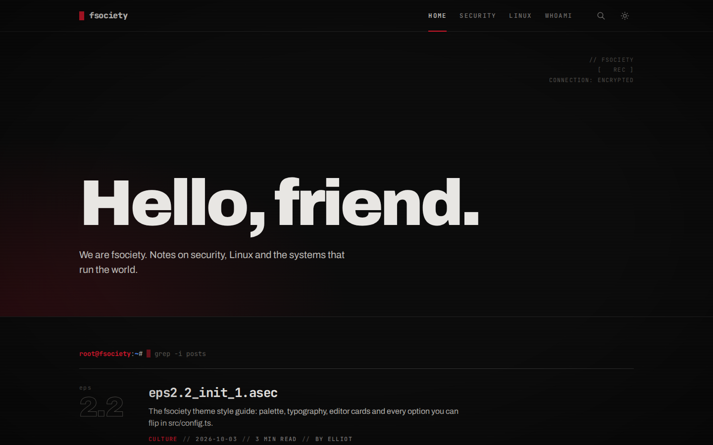

# fsociety (Astro)

A dark, glitchy blog inspired by the TV series **Mr. Robot**: blood red on black, a Kali-style root shell, posts named and numbered like episodes, and errors that look like season 4.

Built with [Astro](https://astro.build): a static site with no server and no database, free to host on GitHub Pages, Cloudflare Pages or Netlify. Posts are Markdown files in this repository.

> Unofficial fan homage. Not affiliated with, endorsed by or connected to Mr. Robot, USA Network, Universal Cable Productions or NBCUniversal. The site ships no logos, artwork or footage from the show.



## Getting started

```sh
npm install
npm run dev       # http://localhost:4321
npm run build     # static site in dist/
npm run preview   # serves dist/
npm run check     # type-checks the project
```

Requires Node 22.12 or newer.

## Writing posts

Every post is a Markdown file in `src/content/posts/`. Use either `<slug>.md` or a folder `<slug>/index.md` with its images next to it. The file or folder name becomes the URL (`/<slug>/`).

```md
---
title: "eps1.0_hellofriend.mov"
excerpt: "The human-readable subtitle under the file-name title."
date: 2026-10-05
tags: ["security"]          # slugs from src/data/tags.json; the first one is the primary tag
cover: ./cover.jpg          # optional, optimized by Astro
coverAlt: "Alt text"        # optional
draft: true                 # optional: shows up in `npm run dev` only
---

Your text in **Markdown**.
```

Other fields: `authors` (slugs from `src/data/authors.json`; defaults to `site.defaultAuthor`), `updated`, `featured` and `coverCaption`.

- **Titles** are set in mono, built for names like the show's episodes: `eps<season>.<episode>_<name>.<ext>`. Regular titles work too.
- **Episode numbers** come from the publish order, computed at build time: the oldest post is `eps1.0`, ten per season. They show on the home page list and above post titles.
- **Pages** like `/whoami/` live in `src/content/pages/`. They take `title`, `excerpt`, `cover` and `showTitle: false` to hide the header.
- **Tags** are listed in `src/data/tags.json` with `id` (the slug), `name` and `description`.
- **Authors** are listed in `src/data/authors.json` with `id`, `name`, `bio`, `avatar` (path relative to the JSON file), `location`, `website` and `social`.

## Settings

Everything lives in [`src/config.ts`](src/config.ts). Change a value and rebuild.

**`site`**: the basics.

| Option | Default | What it does |
|---|---|---|
| `title`, `description` | `fsociety`, … | Site title (in mono after a red block) and description (under the greeting, in the newsletter block and in meta tags) |
| `accentColor` | `#E0182D` | Color of the prompt, buttons, cursor, links and episode numbers |
| `locale` | `en` | Language of the interface strings: `en` or `pt-BR` |
| `defaultAuthor` | `elliot` | Author of posts that don't list any |
| `postsPerPage` | `10` | Posts per page on the home, tag and author pages |
| `navigation`, `secondaryNavigation` | — | Header and footer menus. Header items that don't fit go into the `⋮` menu |
| `social` | — | Profile links shown as icons in the footer. Empty = hidden |

**`theme`**: the look.

| Option | Default | What it does |
|---|---|---|
| `terminalPrompt` | `root@fsociety` | user@host of the shell prompt. A user named `root` gets `#`, anyone else gets `$`. Empty = just `~#` |
| `promptSearch` | `true` | Title search in the prompt on the home, tag and author pages. When off, the prompt shows the command |
| `showBlinkingCursor` | `true` | Blinking red block cursor in the prompt and after the greeting |
| `glitchEffects` | `true` | RGB-split glitch on the logo and titles when hovered, and on the error code |
| `crtScanlines` | `true` | Faint CRT scanlines and a vignette over the whole site |
| `footerTagline` | `Control is an illusion.` | Big line in the footer, also quoted on the 404 page. Empty = no tagline |
| `showHomeIntro` | `true` | The greeting at the top of the home page |
| `introGreeting` | `Hello, friend.` | The greeting |
| `homeIntroText` | — | Text under the greeting; empty = site description |
| `typingAnimation` | `true` | Types the greeting letter by letter |
| `episodeNumbers` | `true` | `eps1.0`, `eps1.1`… on the home page list and above post titles |
| `showAuthor`, `showReadingTime`, `showPublishDate` | `true` | Metadata in the post list |
| `showBreadcrumb` | `true` | Shell breadcrumb at the top of posts and pages (`root@fsociety:~/tag# cat slug`) |
| `showRelatedArticles` | `true` | "Up next": 3 posts that share tags with the current one |

**`newsletter`**: the signup block at the end of posts and in the footer. A static site has no accounts, so the form posts the email to a newsletter service: set `action` to the form endpoint of Buttondown, ConvertKit or similar (e.g. `https://buttondown.com/api/emails/embed-subscribe/<username>`). While it's empty, the block is hidden. `heading` (default `Join fsociety`), `subheading` (default: site description) and `showOnPosts` set the rest.

Dark/light needs no setting: dark is the default, the sun/moon button in the header switches, and each visitor's choice is kept in `localStorage` (`fsociety-theme`) and applied before the page paints.

## Search, RSS and the rest

- **Search**: type after `root@fsociety:~#` to filter posts by title. It reads `/search.json`, generated at build time, so it covers every post, not just the current page (on tag and author pages, only theirs). `/` focuses it, `Enter` opens the first result, `Esc` clears it. The search button in the header focuses the prompt.
- **RSS** is at `/rss.xml` and the sitemap at `/sitemap-index.xml`.
- **Images**: covers are resized and converted to WebP at build time.
- **Comments** aren't built in. [Giscus](https://giscus.app) (GitHub Discussions) is a good fit if you want them.

## Deploying

### GitHub Pages

1. Push this repository to GitHub.
2. In **Settings → Pages**, set **Source** to **GitHub Actions**.
3. Every push to `main` runs [`.github/workflows/deploy.yml`](.github/workflows/deploy.yml) and publishes the site at `https://<user>.github.io/<repo>/`.

For a custom domain or a `<user>.github.io` repository, add the repository variables `SITE_URL` (e.g. `https://blog.example.com`) and `BASE_PATH` (`/`) in **Settings → Secrets and variables → Actions → Variables**.

### Cloudflare Pages or Netlify

Connect the repository. Use build command `npm run build` and output directory `dist`, and set the environment variable `SITE_URL` to the site's address.

## Coming from Ghost?

This site started as the [fsociety Ghost theme](https://github.com/renangabriel27/fsociety-theme). To bring a Ghost blog over, export your content in Ghost Admin (**Settings → Advanced → Import/Export → Export your content**) and run:

```sh
npm run import:ghost -- path/to/export.json --url https://your-ghost-site.com
```

The script writes posts to `src/content/posts/<slug>/index.md` (with the cover next to it), pages to `src/content/pages/`, tags to `src/data/tags.json` and authors to `src/data/authors.json`. It downloads the images in the content to `public/images/<slug>/`. `--url` resolves the `__GHOST_URL__` placeholders in the export. Existing posts are skipped unless you pass `--force`.

The content becomes Markdown, and code blocks keep their language. Editor cards (callouts, toggles, bookmarks, galleries, buttons, HTML cards) stay as HTML inside the Markdown and keep their styles. The demo posts in this repository came from `docs/fsociety-demo-content.json` this way.

## Credits

Based on the official [Source](https://github.com/TryGhost/Source) theme (MIT), by way of [Yaru](https://github.com/renangabriel27/yaru-ghost). Editor card styles in `src/styles/cards.css` come from [Ghost](https://github.com/TryGhost/Ghost) (MIT). Fonts: Archivo and JetBrains Mono (SIL OFL).

## License

MIT. See [LICENSE](LICENSE).
